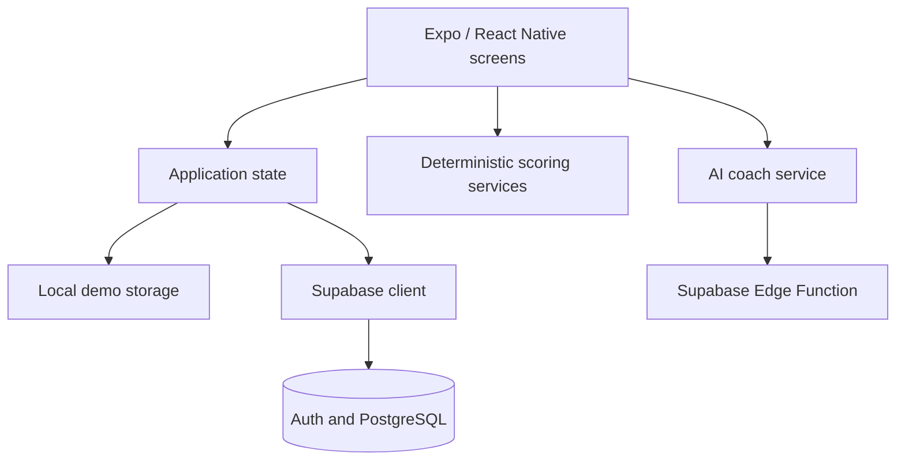

# KyodoAI

**A team-formation app for students and cohort organisers.** Kyodo combines workstyle questionnaires, availability and explainable compatibility scores to help users form teams and discuss how they will work together.

Built by **Malvika and Ethan** for NUS Orbital. This repository contains the shared project; the [commit history](https://github.com/eatenquek/kyodo/commits/main) records individual contributions.

[Project report and walkthrough](ORBITAL_REPORT.md) · [Testing documentation](docs/TESTING.md)

## Main features

- A 15-question workstyle questionnaire with deterministic profile and compatibility scoring.
- Team creation, invitation links and a shared view of members' workstyles and availability.
- Cohort tools that propose group splits using the scoring logic.
- An AI team coach, accessed through a Supabase Edge Function, for discussion and collaboration guidance.
- A local demo mode that works without a hosted backend.

## Architecture

**Stack:** React Native, Expo Router, TypeScript, Supabase Auth/PostgreSQL, Edge Functions and Vitest.



The compatibility and group-formation algorithms live in TypeScript services, separate from the screens. The AI coach adds guidance; the core compatibility scores come from explicit scoring rules.

## Try the local demo

```bash
npm install
npm run web:local
```

Open the web address printed by Expo. Local mode uses one locally stored profile and supports exploring the app without Supabase credentials. It does not reproduce multi-user hosted behaviour.

### Hosted mode

Copy `.env.example` to `.env` and configure your own `EXPO_PUBLIC_SUPABASE_URL` and `EXPO_PUBLIC_SUPABASE_KEY`, then run `npm start`. The `EXPO_PUBLIC_` values are client-visible: use a publishable client key and configure database access rules accordingly. Keep privileged server credentials out of the app.

Hosted mode also needs the database schema, access policies and Edge Function configuration described in the [project report](ORBITAL_REPORT.md). This repository does not include a complete database migration bundle.

## Explore the implementation

| Path | Responsibility |
| --- | --- |
| [app](app) | Expo Router screens and navigation |
| [lib/appState.tsx](lib/appState.tsx) | Application state and local/hosted behaviour |
| [services/scoring](services/scoring) | Questionnaire, workstyle, compatibility and team formation logic |
| [services/cohorts](services/cohorts) | Cohort grouping |
| [services/ai](services/ai) | Coach payloads, availability and error handling |
| [supabase/functions/ai-team-coach](supabase/functions/ai-team-coach) | Server-side AI coach integration |

## Checks available

```bash
npm run typecheck
npm test
```

The suite covers scoring, availability, invitations, team formation and coach payload/error handling. [Testing documentation](docs/TESTING.md) distinguishes automated checks from manual walkthroughs and remaining coverage gaps.

## Limits and next steps

The questionnaire captures self-reported preferences; it is not a validated psychological assessment. Larger cohorts use a bounded search with a fallback rather than exhaustive optimisation. Cohort split proposals are not persisted, and local demo mode supports one profile. The milestone report records further implementation trade-offs and manual testing limitations.
